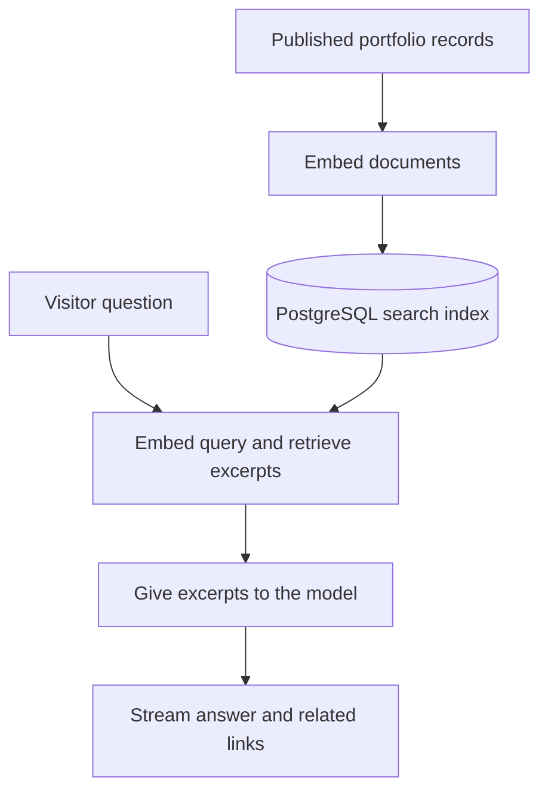

# Freeman Madudili

**Good software makes the next step clear.**

I’m Freeman Madudili, a software engineer. I build intuitive interfaces and reliable workflows that simplify your business operations, using AI where it helps. I turn unclear requirements into practical decisions, build interfaces people can use with confidence, and make handoffs reliable.

[Visit the live portfolio](https://freemanmadudili.com/)

- [Selected work](#selected-work) · [Services](#services) · [Experience and testimonials](#experience-and-testimonials)
- [Core features](#core-features) · [Run it locally](#run-it-locally)

## Selected work

| Project | What it does |
| --- | --- |
| [JPScents](https://freemanmadudili.com/work/jpscents) | A fragrance storefront that lets shoppers browse and check stock before arranging payment and delivery on WhatsApp.<br>[Live site](https://jpscents.shop/) · [GitHub](https://github.com/JPScents/JPScents) |
| [Debby Art & Prints](https://freemanmadudili.com/work/debby-arts) | An artwork and print services website that helps visitors explore the work and put together a custom request.<br>[GitHub](https://github.com/DebbyArts/debbyarts) |
| [Pay4Me / WithRadius](https://freemanmadudili.com/work/pay4me-withradius) | An international payments experience for students paying to study abroad.<br>[Live site](https://withradius.com/) |
| [Portfolio Assistant](https://freemanmadudili.com/work/portfolio-assistant) | An assistant that answers questions about my work with sources and helps visitors get in touch or book a meeting. |
| [Email PA](https://freemanmadudili.com/work/email-pa) | A scheduled workflow that turns Outlook job application emails into Airtable updates and a Telegram summary.<br>[GitHub](https://github.com/Freeman-md/email-pa) |
| [Across the Horizon](https://freemanmadudili.com/work/across-the-horizon) | A study-abroad website rebuilt in Laravel with book purchases, paid consultations, and a blog.<br>[Live site](https://acrossthehorizon.net/) |
| [Interface Studies](https://freemanmadudili.com/work/interface-studies) | Three interactive frontend studies on navigating an inbox, booking a meeting, and acting on a search result.<br>[GitHub](https://github.com/Freeman-md/ui-builds) |
| [Email Sequencer](https://freemanmadudili.com/work/email-sequencer) | A dashboard for preparing, reviewing, and sending outreach through Gmail using an Airtable queue.<br>[GitHub](https://github.com/Freeman-md/email-sequencer) |
| [Self-Healing Backend Ops](https://freemanmadudili.com/work/self-healing-backend-operations-system) | An MSc research testbed comparing rule-based and AI-assisted backend recovery under the same safety controls.<br>[GitHub](https://github.com/Freeman-md/self-healing-backend-ops) |

## Services

**Product development.** Turn a rough idea into a web app, mobile app, or e-commerce product people can use. [Email me about product development](mailto:freemanmadudili@gmail.com?subject=Product%20development%20enquiry&body=Hi%20Freeman%2C%0D%0A%0D%0AWhat%20I%27m%20building%3A%20%0D%0AWho%20it%27s%20for%3A%20%0D%0AWhat%20I%20need%20help%20with%3A%20)

**Automation + AI.** Make repetitive work easier to hand off, track, and complete through intake routing, workflow automation, and AI-assisted triage. [Email me about automation](mailto:freemanmadudili@gmail.com?subject=Automation%20and%20AI%20enquiry&body=Hi%20Freeman%2C%0D%0A%0D%0AHow%20the%20work%20happens%20today%3A%20%0D%0AWhere%20it%20gets%20stuck%3A%20%0D%0AWhat%20a%20better%20handoff%20looks%20like%3A%20)

## Experience and testimonials

[Experience](https://freemanmadudili.com/#experience) · [Testimonials](https://freemanmadudili.com/#testimonials)

## Core features

Next.js builds the public pages from published PostgreSQL records. The deployment serves those built pages, while the assistant searches PostgreSQL at request time.

### How the portfolio assistant answers

The assistant uses retrieval-augmented generation (RAG). It finds relevant excerpts from published work, experience, services, and profile records, then gives the model those excerpts before it answers.



Ask “What did you build for JPScents?” The assistant retrieves excerpts from the JPScents case study and uses them to explain the fragrance storefront and its WhatsApp handoff for payment and delivery. Its source link opens [the JPScents case study](https://freemanmadudili.com/work/jpscents) at `/work/jpscents`.

A full index refresh is simple for this small catalogue. Publishing changes includes an explicit refresh after the site is rebuilt and verified. Source links let readers inspect the case study or section behind the answer. When the records cannot support an answer, the assistant says so.

Follow the [indexing command](src/entrypoints/maintenance/index-portfolio.ts), [search service](src/modules/portfolio/services/portfolio-search.service.ts), and [assistant answer and source handling](src/modules/assistant/service.ts) in the code. The assistant also supports booking a meeting. See the [workflow guide](docs/workflow-foundation.md).

<a name="local-development"></a>

## Run it locally

Use Node.js 22.13 or newer in the 22.x series, npm, Docker, and the Supabase CLI. Create `.env` from [`.env.example`](.env.example) for the local database at `127.0.0.1:54332`. Set `OPENAI_API_KEY` for indexing and chat, and set `RATE_LIMIT_HMAC_SECRET` for chat. The example lists the provider settings for Meeting and the standalone Contact service.

```sh
npm ci
supabase start
npm run prisma:migrate
npm run portfolio:seed:local -- --apply
npm run portfolio:index
npm run dev
```

Open [localhost:3000](http://localhost:3000). See the [operations guide](docs/portfolio-content-system.md) for seeding, rebuilding, and refreshing the search index. If a failed migration left disposable local data, confirm the database is local before running `npx prisma migrate reset`, then reapply the seed and refresh the index.

### Verification

Set `PORTFOLIO_TEST_DATABASE_URL` to a disposable PostgreSQL server with pgvector and permission to create test databases.

```sh
npm run prisma:validate
npm run prisma:generate
npm run lint
npm run typecheck
npm test
npm run test:portfolio:database
npm run build
```
